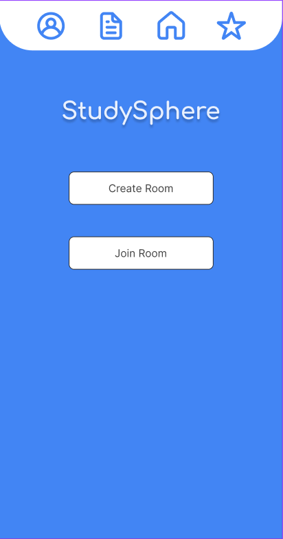
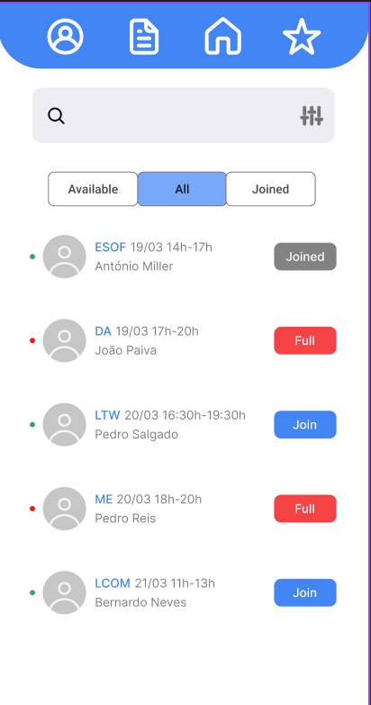
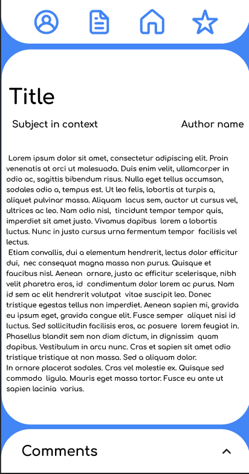
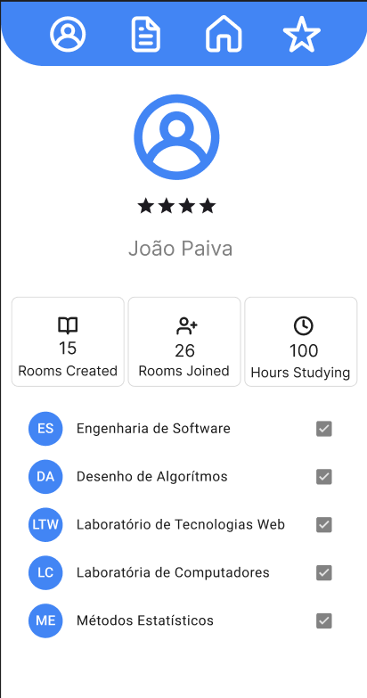

# StudySphere

A cross-platform mobile app for group study. Students create or join study rooms by subject, chat in real time with the people in the room, and ask questions in a Q&A forum.

Built with **Flutter** and **Firebase** over 4 Scrum sprints, as the team project for the Software Engineering course (L.EIC, FEUP, 2024/25). Final grade: **17/20**.

<p align="center">
  
  
  
  
</p>

## Features

- **Authentication** with email/password and Google Sign-In (Firebase Auth)
- **Study rooms** grouped by subject: create a room, browse available rooms, join one, and see the rooms you have joined
- **Real-time chat** inside each study room (Cloud Firestore)
- **Q&A forum** to post questions and answer other students
- **Profile page** with the student's data

## Tech stack

| Area | Technologies |
|---|---|
| Mobile app | Flutter, Dart |
| Backend | Firebase Authentication, Cloud Firestore |
| Testing | Flutter widget and unit tests |
| Process | Scrum (4 sprints), GitHub Projects, user stories with acceptance tests |
| Design | Mockups, UML domain, package and deployment diagrams |

## My contribution

- Implemented the **study rooms** feature on Cloud Firestore: room creation, room list, room details and "my rooms"
- Built the **Q&A forum** page and post creation
- Redesigned the app's **visual identity** (theme, name and icon) for the final release
- Wrote the **product vision**, the **UML architecture diagrams** and the prototype, and kept the sprint documentation up to date

## Running the app

The Firebase configuration files are not included in this repository. To run the app, create your own Firebase project and add its configuration:

```bash
flutter pub get
flutterfire configure   # generates the Firebase config for your project
flutter run
```

## Project documentation

The full development report (product vision, user stories, domain model, architecture and the Scrum sprint reviews) is in [DEVELOPMENT_REPORT.md](DEVELOPMENT_REPORT.md).

## Team

António Miller, Bernardo Neves, Donovan Hele, Pedro Salgado
