<!-- Template file for README.md for LEIC-ES-2023-24 -->

# **Study Sphere** Development Report

Welcome to the documentation pages of **Study Sphere**!

This Software Development Report, tailored for LEIC-ES-2024-25, provides comprehensive details about **Study Sphere**, from high-level vision to low-level implementation decisions. It’s organised by the following activities. 

* [Business modeling](#Business-Modelling) 
  * [Product Vision](#Product-Vision)
  * [Features and Assumptions](#Features-and-Assumptions)
  * [Elevator Pitch](#Elevator-pitch)
* [Requirements](#Requirements)
  * [User stories](#User-stories)
  * [Domain model](#Domain-model)
* [Architecture and Design](#Architecture-And-Design)
  * [Logical architecture](#Logical-Architecture)
  * [Physical architecture](#Physical-Architecture)
  * [Vertical prototype](#Vertical-Prototype)
* [Project management](#Project-Management)
  * [Sprint 0](#Sprint-0)
  * [Sprint 1](#Sprint-1)
  * [Sprint 2](#Sprint-2)
  * [Sprint 3](#Sprint-3)
  * [Sprint 4](#Sprint-4)
  * [Final Release](#Final-Release)

Contributions are expected to be made exclusively by the initial team, but we may open them to the community, after the course, in all areas and topics: requirements, technologies, development, experimentation, testing, etc.

Please contact us!

Thank you!

* António Miller up202008423@up.pt
* Bernardo Neves up202307553@up.pt
* Donovan Hele up202309344@up.pt  
* Pedro Salgado up202204914@up.pt

---
## Business Modelling

Business modeling in software development involves defining the product's vision, understanding market needs, aligning features with user expectations, and setting the groundwork for strategic planning and execution.

### Product Vision

For students seeking a more collaborative and productive study experience, **StudySphere** is an application that enables the creation of study rooms categorized by subject or simply joining existing ones. In addition to offering a forum for clearing doubts, **StudySphere** provides a student rating system and personalized statistics, ensuring an organized, motivating, and dynamic group study environment.
<!-- 
Start by defining a clear and concise vision for your app, to help members of the team, contributors, and users into focusing their often disparate views into a concise, visual, and short textual form. 

The vision should provide a "high concept" of the product for marketers, developers, and managers.

A product vision describes the essential of the product and sets the direction to where a product is headed, and what the product will deliver in the future. 

**We favor a catchy and concise statement, ideally one sentence.**

We suggest you use the product vision template described in the following link:
* [How To Create A Convincing Product Vision To Guide Your Team, by uxstudioteam.com](https://uxstudioteam.com/ux-blog/product-vision/)

To learn more about how to write a good product vision, please see:
* [Vision, by scrumbook.org](http://scrumbook.org/value-stream/vision.html)
* [Product Management: Product Vision, by ProductPlan](https://www.productplan.com/glossary/product-vision/)
* [How to write a vision, by dummies.com](https://www.dummies.com/business/marketing/branding/how-to-write-vision-and-mission-statements-for-your-brand/)
* [20 Inspiring Vision Statement Examples (2019 Updated), by lifehack.org](https://www.lifehack.org/articles/work/20-sample-vision-statement-for-the-new-startup.html)
-->

### Features and Assumptions
**User Authentication** –> Students can log in securely to maintain personalized data and preferences.

**Study Room Management** –> Ability to create, categorize by subject, and join existing study rooms.

**Forums for Doubts** –> Allows students to post and answer questions, enhancing collaboration and mutual assistance.

**Subject-based Room Categorization** –> Enables students to find and join study rooms relevant to their subjects quickly.

**Peer Rating System** –> Students can rate each other's participation, motivating active engagement and assisting in choosing study partners.

**Personalized Study Statistics** –> Tracks and displays individual statistics on time spent studying per subject, helping students analyze their productivity.

* Students have an institutional email or account to authenticate.
* Users actively participate in peer-rating, ensuring effective evaluation and reliability.
* The application relies on consistent internet connectivity.
* Institutional data (e.g., subjects, courses) is available for room categorization and subject tagging.
<!-- 
Indicate an  initial/tentative list of high-level features - high-level capabilities or desired services of the system that are necessary to deliver benefits to the users.
 - Feature XPTO - a few words to briefly describe the feature
 - Feature ABCD - ...
...

Optionally, indicate an initial/tentative list of assumptions that you are doing about the app and dependencies of the app to other systems.
-->

### Elevator Pitch
Are you tired of studying alone or struggling to find study groups? Meet **StudySphere**, the perfect solution for university students craving collaboration and productivity. With **StudySphere**, you can effortlessly create or join study rooms tailored to your subjects, participate in forums to clarify doubts, and even rate your peers' participation. Plus, our personalized study statistics help you track and boost your academic performance. Revolutionize the way you study, join **StudySphere** and unlock the power of group learning today!
<!-- 
Draft a small text to help you quickly introduce and describe your product in a short time (lift travel time ~90 seconds) and a few words (~800 characters), a technique usually known as elevator pitch.

Take a look at the following links to learn some techniques:
* [Crafting an Elevator Pitch](https://www.mindtools.com/pages/article/elevator-pitch.htm)
* [The Best Elevator Pitch Examples, Templates, and Tactics - A Guide to Writing an Unforgettable Elevator Speech, by strategypeak.com](https://strategypeak.com/elevator-pitch-examples/)
* [Top 7 Killer Elevator Pitch Examples, by toggl.com](https://blog.toggl.com/elevator-pitch-examples/)
-->

## Requirements

### User Stories

1) As a **student**, I want to Authenticate so that I have personalized data. ([**Authentication**](https://github.com/LEIC-ES-2024-25/2LEIC12T2/issues/2))  
   [**Account Creation**](images/mockups/CreateAccount.png) | [**Log In**](images/mockups/LogIn.png)

2) As a **student**, I want to create or join a study room so that I can study with company. ([**Study Room Creation and Joining**](https://github.com/LEIC-ES-2024-25/2LEIC12T2/issues/1))  
   [**Home Page**](images/mockups/HomePage.png) | [**Room Creation**](images/mockups/RoomCreation.png)

3) As a **student**, I want to create forums so that I can submit my doubts. ([**Forum Creation**](https://github.com/LEIC-ES-2024-25/2LEIC12T2/issues/6))  
   [**Forum Creation**](images/mockups/ForumCreation.png) | [**Forum Page**](images/mockups/ForumPage.png) | [**Forum Search**](images/mockups/ForumSearch.png)

4) As a **student**, I want to easily find a study room accordingly to my subjects, so that I can connect with relevant partners. ([**Subject-Based Study Rooms**](https://github.com/LEIC-ES-2024-25/2LEIC12T2/issues/3))  
   [**Joining Room (All)**](images/mockups/JoinRoomAll.png) | [**Joining Room (Available)**](images/mockups/JoinRoomAvailable.png) | [**Joining Room (Joined)**](images/mockups/JoinRoomJoined.png)

5) As a **student**, I want to rate my colleagues participation in the study room and view their ratings, so that I can encourage active participation and make informed choices about study partners. ([**Colleague Rating**](https://github.com/LEIC-ES-2024-25/2LEIC12T2/issues/4))  
   [**Profile**](images/mockups/Profile.png) | [**Room You Joined**](images/mockups/RoomYouJoined.png) | [**Room You Created**](images/mockups/YourRoom.png)

6) As a **student**, I want to access my statistics, so that I can track how much time I’ve been studying for each subject. ([**Statistics Viewer**](https://github.com/LEIC-ES-2024-25/2LEIC12T2/issues/5))  
   [**Statistics**](images/mockups/Statistics.png)

<!-- 
In this section, you should describe all kinds of requirements for your module: functional and non-functional requirements.

For LEIC-ES-2024-25, the requirements will be gathered and documented as user stories. 

Please add in this section a concise summary of all the user stories.

**User stories as GitHub Project Items**
The user stories themselves should be created and described as items in your GitHub Project with the label "user story". 

A user story is a description of a desired functionality told from the perspective of the user or customer. A starting template for the description of a user story is *As a < user role >, I want < goal > so that < reason >.*

Name the item with either the full user story or a shorter name. In the “comments” field, add relevant notes, mockup images, and acceptance test scenarios, linking to the acceptance test in Gherkin when available, and finally estimate value and effort.

**INVEST in good user stories**. 
You may add more details after, but the shorter and complete, the better. In order to decide if the user story is good, please follow the [INVEST guidelines](https://xp123.com/articles/invest-in-good-stories-and-smart-tasks/).

**User interface mockups**.
After the user story text, you should add a draft of the corresponding user interfaces, a simple mockup or draft, if applicable.

**Acceptance tests**.
For each user story you should write also the acceptance tests (textually in [Gherkin](https://cucumber.io/docs/gherkin/reference/)), i.e., a description of scenarios (situations) that will help to confirm that the system satisfies the requirements addressed by the user story.

**Value and effort**.
At the end, it is good to add a rough indication of the value of the user story to the customers (e.g. [MoSCoW](https://en.wikipedia.org/wiki/MoSCoW_method) method) and the team should add an estimation of the effort to implement it, for example, using points in a kind-of-a Fibonnacci scale (1,2,3,5,8,13,20,40, no idea).

-->

### Domain model

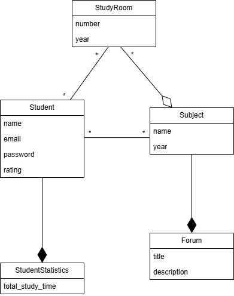

>**Student**(<ins>id_student</ins>, name, email, password, rating)\
**Subject**(<ins>id_subject</ins>, name, year)\
**StudyRoom**(<ins>id_studyroom</ins>, number, id_subject->Subject)\
**Forum**(<ins>id_forum</ins>, title, descprition, id_subject->Subject)\
**StudentStatistics**(<ins>id_statistics</ins>, total_study_time, id_student->Student)\
**Student_StudyRoom**(<ins>id_student</ins>->Student, <ins>id_studyroom</ins>->StudyRoom)
<!-- 
To better understand the context of the software system, it is useful to have a simple UML class diagram with all and only the key concepts (names, attributes) and relationships involved of the problem domain addressed by your app. 
Also provide a short textual description of each concept (domain class). 

Example:
 

  

-->

## Architecture and Design
<!--
The architecture of a software system encompasses the set of key decisions about its organization. 

A well written architecture document is brief and reduces the amount of time it takes new programmers to a project to understand the code to feel able to make modifications and enhancements.

To document the architecture requires describing the decomposition of the system in their parts (high-level components) and the key behaviors and collaborations between them. 

In this section you should start by briefly describing the components of the project and their interrelations. You should describe how you solved typical problems you may have encountered, pointing to well-known architectural and design patterns, if applicable.
-->

### Logical architecture

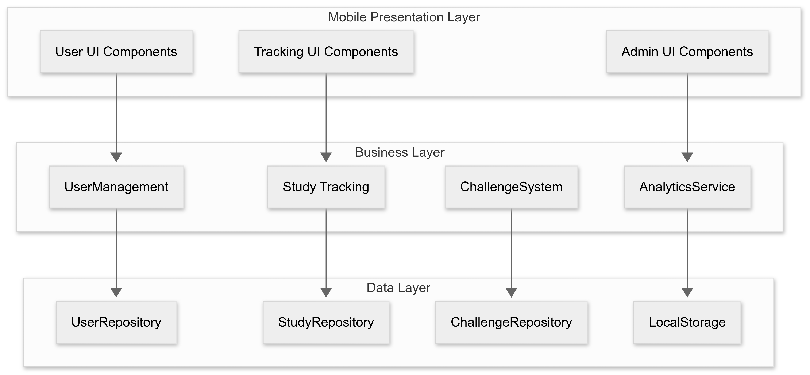

The **Presentation Layer** includes User UI Components, Tracking UI Components, and Admin UI Components, which represent different user interfaces of the application. The **Business Layer** manages core functionalities, such as User Management, Study Tracking, Challenge System, and Analytics Service, ensuring proper handling of user interactions and logic. Finally, the **Data Layer** consists of repositories and local storage components responsible for storing and retrieving data.
<!--
The purpose of this subsection is to document the high-level logical structure of the code (Logical View), using a UML diagram with logical packages, without the worry of allocating to components, processes or machines.

It can be beneficial to present the system in a horizontal decomposition, defining layers and implementation concepts, such as the user interface, business logic and concepts.

Example of _UML package diagram_ showing a _logical view_ of the Eletronic Ticketing System (to be accompanied by a short description of each package):

-->

### Physical architecture

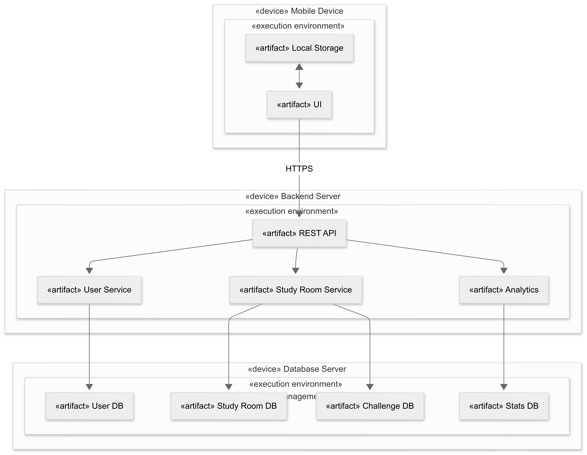

The application consists of three main environments: **Mobile Device**, **Backend Server**, and **Database Server**. On the **Mobile Device**, users interact with the application through a UI, which uses Local Storage for local data persistence. The device communicates via HTTPS with the **Backend Server**, which provides a REST API and manages several services, including User Service, Study Room Service, and Analytics. These services connect directly to the **Database Server**, storing data in dedicated databases for users, study rooms, challenges, and statistics.
<!--
The goal of this subsection is to document the high-level physical structure of the software system (machines, connections, software components installed, and their dependencies) using UML deployment diagrams (Deployment View) or component diagrams (Implementation View), separate or integrated, showing the physical structure of the system.

It should describe also the technologies considered and justify the selections made. Examples of technologies relevant for ESOF are, for example, frameworks for mobile applications (such as Flutter).

Example of _UML deployment diagram_ showing a _deployment view_ of the Eletronic Ticketing System (please notice that, instead of software components, one should represent their physical/executable manifestations for deployment, called artifacts in UML; the diagram should be accompanied by a short description of each node and artifact):

-->

### Vertical prototype
**Study Room Creation and Joining**\
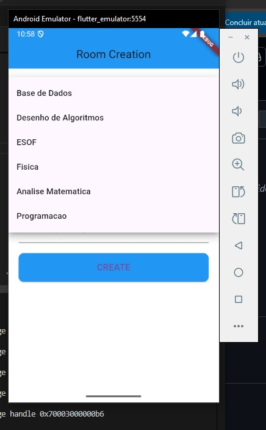
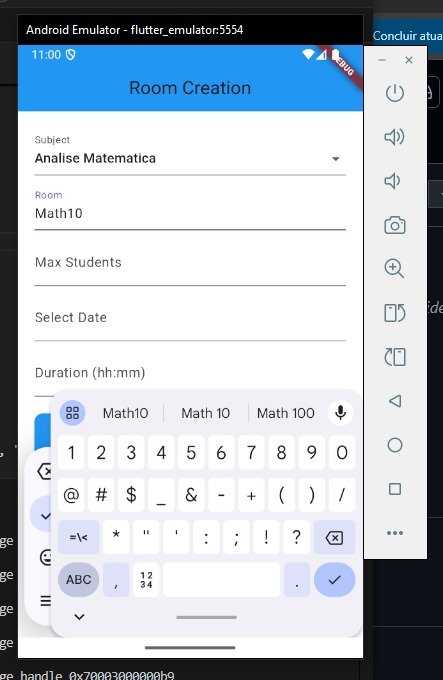
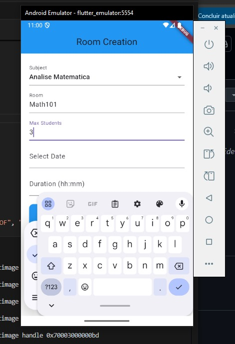
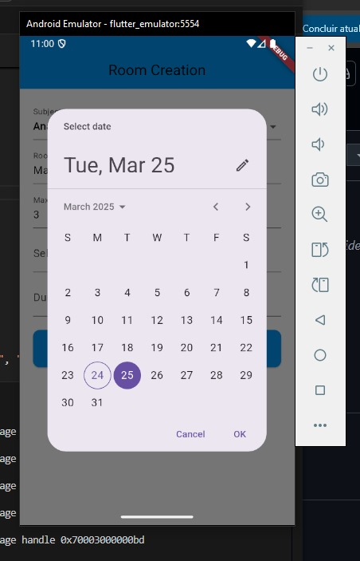
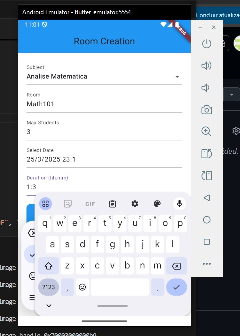
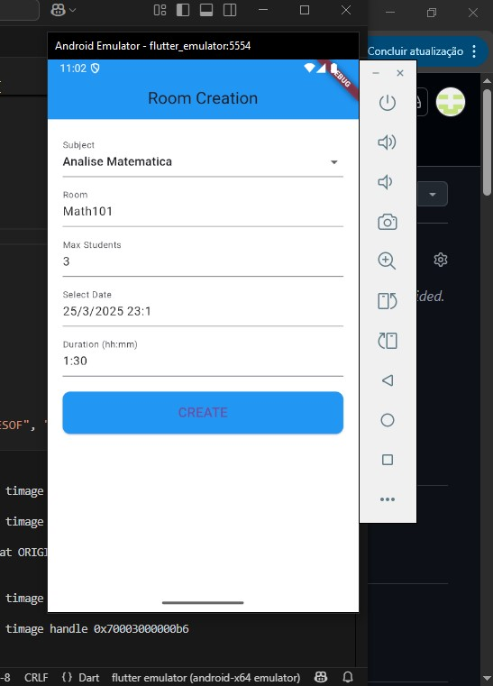
<!--
To help on validating all the architectural, design and technological decisions made, we usually implement a vertical prototype, a thin vertical slice of the system integrating as much technologies we can.

In this subsection please describe which feature, or part of it, you have implemented, and how, together with a snapshot of the user interface, if applicable.

At this phase, instead of a complete user story, you can simply implement a small part of a feature that demonstrates thay you can use the technology, for example, show a screen with the app credits (name and authors).
-->

## Project management
<!--
Software project management is the art and science of planning and leading software projects, in which software projects are planned, implemented, monitored and controlled.

In the context of ESOF, we recommend each team to adopt a set of project management practices and tools capable of registering tasks, assigning tasks to team members, adding estimations to tasks, monitor tasks progress, and therefore being able to track their projects.

Common practices of managing agile software development with Scrum are: backlog management, release management, estimation, Sprint planning, Sprint development, acceptance tests, and Sprint retrospectives.

You can find below information and references related with the project management: 

* Backlog management: Product backlog and Sprint backlog in a [Github Projects board](https://github.com/orgs/FEUP-LEIC-ES-2023-24/projects/64);
* Release management: [v0](#), v1, v2, v3, ...;
* Sprint planning and retrospectives: 
  * plans: screenshots of Github Projects board at begin and end of each Sprint;
  * retrospectives: meeting notes in a document in the repository, addressing the following questions:
    * Did well: things we did well and should continue;
    * Do differently: things we should do differently and how;
    * Puzzles: things we don’t know yet if they are right or wrong… 
    * list of a few improvements to implement next Sprint;

-->

### Sprint 0
**Done:**  
User stories ✅  
Domain Model ✅  
Logical and Physical Architecture ✅  
Mockups ✅  
First Vertical Prototype ✅  

**Sprint1 Planning:**  
Firebase  
Authentication  
### Sprint 1
- Scrum board at the end of the Sprint 1 Planning:

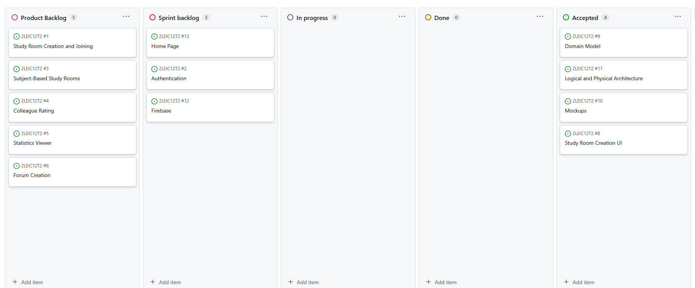

- Scrum board after Sprint 1:

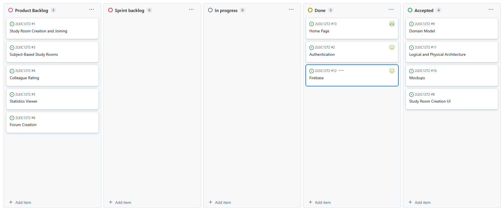

- Sprint Review:

The demonstration of the product increment was successfully done, however, there's an unresolved issue with signing in using Google, and the root cause is still unclear. The app lacks visual identity, but overall the goals of the sprint 1 were achieved and the new features add value to the end user. The release of the increment was created on GitHub.

- Sprint Retrospective:

All planned features were successfully implemented, and we're satisfied with the team's performance. A minor issue remains with the Google Sign-In functionality, which we intend to address in the next iteration. We also plan to further explore ways to enhance the app's visual identity moving forward.

- Happiness Meter:

We are very happy about our performance in the sprint 1.

### Sprint 2

- Scrum board at the end of the Sprint 2 Planning:

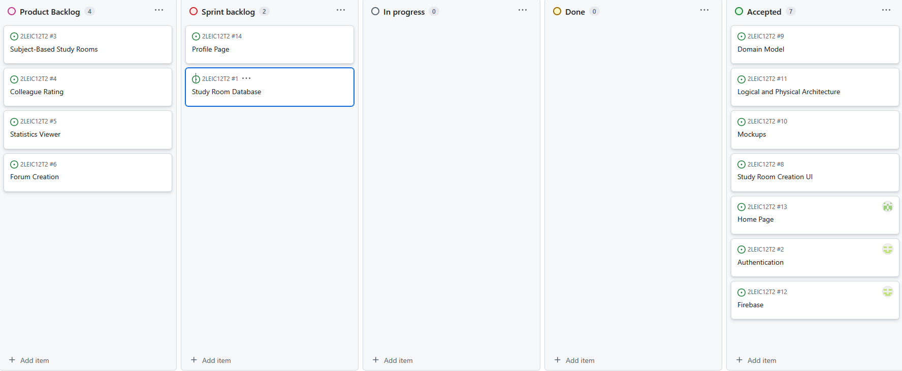

### Sprint 3

### Sprint 4

### Final Release

